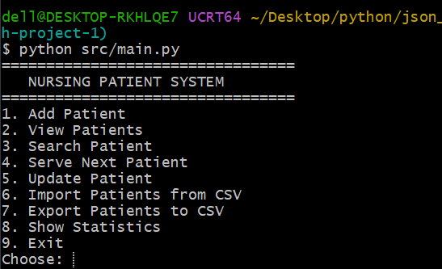
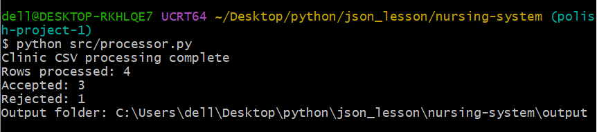

# Clinic Operations Data Processor

A beginner-friendly Python project that combines an interactive patient management application with a CSV data-processing pipeline.

This educational portfolio project demonstrates Python functions, modular code, file handling, CSV and JSON processing, data validation, regular expressions, object-oriented programming, command-line arguments, and automated testing.

All included patient records are fictional.

## Features

### Patient Management

- Add, view, search, and update patient records.
- Serve the next waiting patient.
- Import patient records from CSV.
- Export patient records to CSV.
- Display patient statistics.
- Validate patient names, ages, phone numbers, and room values.
- Store working patient data as JSON.

### CSV Data Processing

- Read UTF-8 CSV files and check required columns.
- Clean whitespace and validate each row independently.
- Use a `Patient` data class to represent validated records.
- Record rejected rows with their line numbers and validation reasons.
- Export accepted records, rejected records, and summary counts as JSON.
- Support custom input files and output directories.

## Project Structure

```text
nursing-system/
├── src/
│   ├── main.py
│   ├── patient.py
│   ├── patients.py
│   ├── patient_statistics.py
│   ├── processor.py
│   ├── storage.py
│   └── validation.py
├── tests/
├── sample_data/
│   ├── patients.csv
│   └── patients.json
├── screenshots/
├── output/                 # Generated locally
├── README.md
├── requirements.txt
├── pytest.ini
├── .gitignore
└── LICENSE
```

## Requirements

- Python 3.10 or newer
- `pytest` for running tests

Install the development dependency:

```bash
python -m pip install -r requirements.txt
```

The application uses only the Python standard library at runtime.

## Run the Patient Management Application

From the repository root, run:

```bash
python src/main.py
```

The application provides a menu for managing patient records.

Working data is stored locally in `patients.json` in the repository root. If this file does not exist, the application loads the fictional sample records from `sample_data/patients.json`.

## Run the CSV Processor

Process the included sample CSV file:

```bash
python src/processor.py
```

By default, the processor reads `sample_data/patients.csv` and writes its results to `output/`:

- `patients_cleaned.json`
- `patients_rejected.json`
- `report.json`

Process another CSV file and choose an output directory:

```bash
python src/processor.py path/to/clinic.csv --output-dir output
```

Display the available command-line options:

```bash
python src/processor.py --help
```

## Input Format

The CSV file must include the following columns:

| Field | Validation rule |
|---|---|
| `name` | Required; repeated whitespace is collapsed |
| `age` | Whole number from 1 to 120 |
| `phone` | 7–20 digits; may include `+`, spaces, parentheses, or hyphens |
| `room` | Required; surrounding whitespace is removed |

Rows that fail validation are recorded in the rejected JSON output. Processing continues with the next row.

## Run Tests

Run the automated test suite from the repository root:

```bash
python -m pytest
```

The tests cover the main application, patient operations, data processing, statistics, storage, and validation.

## Screenshots

### Patient Management Menu



The interactive menu provides options for adding, viewing, searching, and updating patient records, importing and exporting CSV files, and viewing statistics.

### CSV Processing Results



The CSV processor validates sample records, reports accepted and rejected rows, and saves the generated JSON files in the local `output/` directory.

## Privacy

This is an educational project, not a clinical system. Use fictional data only. Never commit real patient records or other sensitive information to a public repository.

Generated working data and processing outputs are excluded from version control.

## License

This project is licensed under the MIT License. See [LICENSE](LICENSE).